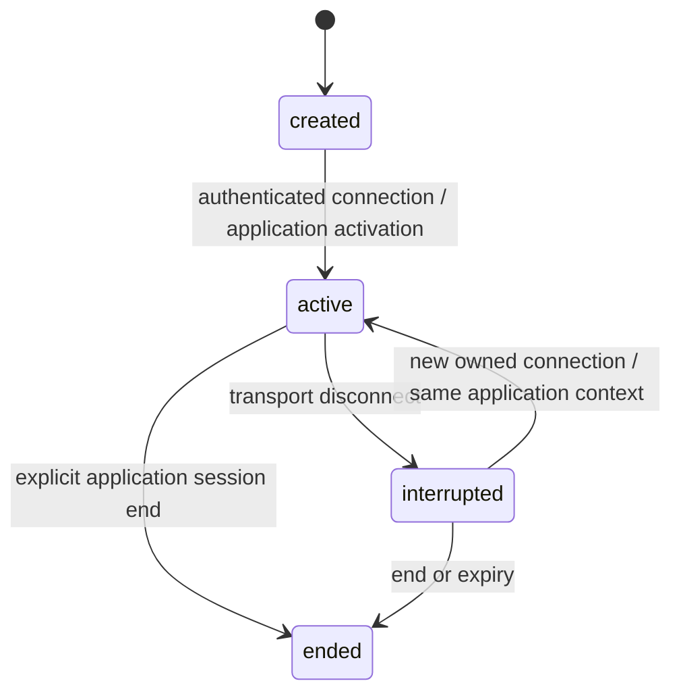

# RE:SONANCE — V1 agent and adapter design

Status: planning contract v2.0.0. ElevenLabsAdapter is the V1 implementation target; neither it nor GeminiLiveAdapter is implemented in this repository.

## Provider-independent boundary

[voice_agent_adapter.json](../contracts/voice_agent_adapter.json) defines VoiceAgentAdapter. It normalizes mode-specific connect/disconnect, typed input, context updates, microphone mute, playback volume and connection/message/tool/speaking events. It never receives camera view refs, frames, files, URIs or tracks. LocalCameraPreviewController is a separate frontend owner. Future VisionCapableAdapter methods belong only to an explicit V2 integration, not this base interface.

V1 ElevenLabsAdapter wraps the chosen React Native SDK in its required React provider/hook lifecycle; do not call hooks from an arbitrary class constructor. A facade can expose the provider-independent port to the bridge. SDK/package/API pins require G0 verification. Use a private agent and server-issued WebRTC conversation token for voice; text mode is a separate textOnly signed WebSocket connection, not audio muted as a substitute for chat. Neither needs Gemini keys/SDKs.

Python Conversation Controller remains authoritative for guided questions, skipped/known/missing fields and session state. Application session ID/context survives provider-native connection changes. Backend-approved AgentContext contains structured summary, current question/preferences/recommendations and accepted activity. Use permitted initialization variables/context updates supported by the pinned SDK; do not let arbitrary client prompt overrides replace safety policy. Restore accepted state, not an invented exact unretained transcript.

## State machines

Each provider connection separately transitions created → connecting → active → interrupted/closed. Closing voice for text mode does not set the application session ended. Camera states off/requesting/previewing/denied/suspended are independent and are not provider/backend state. Mode switch closes the previous transport before bootstrapping another and preserves the controller version/current activity.

Guided flow remains discover_missing → optional question → explicit answer or skip → propose/confirm → recommend → activity → feedback → conversation. get_next_guided_question does not advance state; accepted answer/skip/confirmation does. Fixed mood/energy/sleep wording/scales and skip behavior remain. Do not let a model claim that a question was answered or a fact was confirmed.

## Client tools and trusted decisions

The six tools in [tool_contracts.json](../contracts/tool_contracts.json) are unchanged in purpose:

| Tool | Trusted effect / UI boundary |
| --- | --- |
| get_patient_context | Return minimal owned context only. |
| get_next_guided_question | Return deterministic controller question/version. |
| present_activity_recommendations | Backend supplies current Recommendation; apply exact cards before resolving blocking handler. |
| propose_observation | Proposed patient fact; confirmation/correction remains a patient UI action. |
| select_activity | Voice maps to a currently offered backend activity/version; touch uses the same startActivity use case. |
| request_clinician_review | Record explicit intent only after patient confirmation; never promise recipient visibility or emergency response. |

Register matching names/parameters in the saved ElevenLabs agent and SDK client. Enable Wait for response for result-bearing tools. Callback promise waits for authenticated FastAPI outcome, then required UI application, before returning serialized canonical result to the agent. The SDK resolves its native call; do not assume Gemini send_tool_response or a native tool ID is present in every handler signature.

Normalize invocation identity once per callback lifecycle, namespace it by connection_id and retain it across backend retries/rerenders. If native stable ID is exposed and verified, map it; otherwise use a local UUID and do not claim replay-proof provider identity after app restart. Existing business constraints still prevent duplicate active selections, terminal events, feedback and conflicting versions. A repeated key with changed args fails. Closed connections cannot execute new tools. Tool errors produce honest failure, never fabricated successful cards/completion.

No camera/vision/screenshot/record/upload tool is exposed. No tool grants sharing, confirms/corrects a fact, mutates memory, executes JS/SQL, starts an unoffered activity or marks it complete. Prompt injection cannot change backend authority. Review intent and app activity feedback are distinct from provider conversation-quality feedback.

## Recommendation and activity context loop

ElevenAgents client tool → bridge → dispatchTool → recommendation engine → Recommendation including stable recommendation_id/activity_id/activity_version → UI reducer applies current options → SDK callback resolves with the same data → agent speaks those options. Late batches are rejected/reconciled before narration; no title-based selection. After accepted selection, local renderer runs while the same application session remains active. Keep accepted activity state through provider pause/reconnect. Completing/abandoning and rating writes use existing endpoints; invalidate getMyJourney after ACK and update agent context with accepted outcome. Local animation frames never trigger backend calls.

## Text mode and message persistence

Open a separate textOnly provider connection without microphone capture, preserving application conversation ID and AgentContext. Typed input and assistant replies are text events; there is no V1 Gemini AUDIO-only workaround. Turning camera on never supplies visual context to either mode.

ElevenLabs does not persist RE records automatically. Adapter normalizes tentative/final user/agent events with application connection_id, server-allocated epoch, turn/sequence/client_message_id. Verify finality/corrections in the selected SDK; do not invent universal native is_final or call IDs. Barge-in/disconnect marks interrupted/partial rather than filling missing turns. History off means no text retention POST. With active transcript consent, MessageBatch is ingested atomically and deduplicated; late text from closed connection must fit its recorded time and current grant. No provider history/audio retrieval or content webhooks are part of this pipeline.

Conversation Service owns consented history and source-linked summaries. Off-history summaries use confirmed records, not hidden dialogue. Extraction can propose facts from consented patient turns or explicit structured answers, never assistant speech or speculative affect. Patient confirms/rejects/edits; edited confirmation preserves rejected proposal and new confirmed row, while later correction supersedes confirmed predecessor. Keep source IDs/revisions and report invalidation. Explicit patient memory UI remains the only writer; model tools cannot persist preferences silently.

## V1 agent persona and privacy

Agent must never claim it can see the patient, room, objects, camera or surroundings. If asked, explain video is only local preview; reflect verbally described surroundings only as patient statements. Required UI disclosure is “Camera preview only — RE cannot see your video yet.” No diagnostics, physiology inference, TMS instruction or emergency-monitoring promise is added.

Provider-side audio saving and conversation retention are independent from RE transcript consent. Before bootstrap, operator must verify actual saved agent privacy settings; default recording/history are not accepted. Zero-day scheduled deletion is not ZRM. See PROVIDER_VERIFICATION.md and provider_privacy.requirements.json for pending evidence and fail-closed gate. Only fictional patient data is permitted in the MVP.

## V2 scope

GeminiLiveAdapter is a future implementation of the shared conversation contract plus a separately gated vision extension. Revisit model/audio/frame limits, credentials, resumption and explicit transmission consent then. No Gemini initialization, dependency or camera-send capability belongs to V1.
