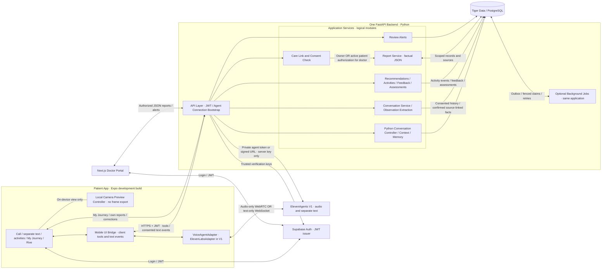

# RE:SONANCE — Implementation architecture

Status: planning contract v2.0.0, 14 November 2026. V1 targets ElevenAgents; no application implementation or provider setup is present. Fictional patient data only.

## Decisions retained and phased change

Keep React Native/Expo, local Rive, Python Conversation Controller, one FastAPI modular monolith, one Tiger Data/PostgreSQL application database, Supabase identity, patient-controlled consent and in-app JSON reports. No new microservice or database is introduced. V1 replaces the realtime provider integration with ElevenLabsAdapter; GeminiLiveAdapter is future V2 and cannot be required to start any V1 flow.

The patient camera is a strictly local preview in V1. No frames, video tracks, screenshots, recording, files, image URIs, media uploads or camera-state API fields exist. Preview permission/lifecycle is independent of provider connection and microphone. UI copy: “Camera preview only — RE cannot see your video yet.”

## Component architecture

The local preview has no arrow to the adapter, provider, backend or database. It is not a video call. V2 Gemini Live audio/optional frame transport is a future adapter extension with separate transmission consent, absent from V1 API and dependencies.

## Deployment and ownership

Patient development build and clinician browser call the same FastAPI application over HTTPS. V1 voice connects directly through ElevenLabs SDK/WebRTC; separate text mode uses authenticated WebSocket. API Layer obtains provider credentials and validates all trusted operations; no audio proxy, video ingest service or camera storage is added. Host choice (Modal/Vultr), portal hosting, region and job supervision remain open.

Python API Layer, Application Services and optional job runner are logical modules of one application, not separate servers. Keep domain/application code independent of provider SDK/HTTP/ORM types; use ports, explicit UoW, one database session per concurrent use case, thin routes and a composition root. SQLAlchemy async and final runtime versions remain a reviewed implementation choice. No product package manifests or native/Rive build assets currently exist.

| Owner | Responsibilities |
| --- | --- |
| LocalCameraPreviewController | Separate camera permission, focused foreground preview, release on off/unfocus/background/revocation; no capture/export interface. |
| VoiceAgentAdapter | Normalized connect/disconnect, voice mute/output, separate text input, accepted-context updates and events; no camera/frame method. |
| ElevenLabsAdapter | V1 SDK integration, private voice/text credentials, normalized client-tool callbacks and message events. Required V1 implementation, not yet implemented. |
| Mobile UI Bridge | Authenticated tools, UI state, exact activity cards/IDs, voice/touch selection, opt-in text ingestion and My Journey invalidation. |
| Python Controller / Context | Guided questions/skip, known/missing confirmed facts, session versions and approved context shared across provider connections. |
| Conversation / Extraction | Consented transcripts, partial session summaries, proposed facts, source references, patient confirmation/correction. |
| Activity / Recommendation | Catalog eligibility/ranking, current recommendation IDs, activity lifecycle and explicit feedback. |
| Report / Care / Alerts | Current confirmed observations/activity feedback/assessments → factual JSON, owner/active clinician authorization and explicit review notifications. |
| PostgreSQL / Jobs | Existing persistent records plus provider connection metadata; transactional outbox and idempotent processing; no provider credentials/camera state/media. |

## V1 session/bootstrap contract

Create application session (voice or text; no camera field) → createAgentConnection with expected_version → API checks owner/session and actual attested agent privacy config → allocate owned connection_id/connection_epoch → return AgentConnectionBootstrap → SDK connects → updateAgentConnection lifecycle. New route replaces the earlier Gemini-specific live-credentials contract. Provider ID is metadata, never an authorization token.

Voice bootstrap returns ElevenLabs conversation_token for WebRTC. Text bootstrap returns a signed_url for textOnly WebSocket. Server selects agent/provider; clients cannot request Gemini in V1. Secrets are transient/no-store and never SQL-cached. connect_before is a RE start guard; credential_expires_at is null when provider expiry is not actually reported. Permanent ElevenLabs key stays in backend secrets. Missing verified provider privacy configuration returns PROVIDER_PRIVACY_UNVERIFIED instead of silently accepting provider defaults.

Mode switch ends/closes the old provider transport, leaves the application session alive, and bootstraps a new mode-specific connection with AgentContext. Backend supplies the same guided question, preferences, current recommendation and accepted activity state/context version. Do not invent exact provider transcript continuity; off-history mode restores confirmed state rather than hidden conversation text. New provider IDs do not reset patient progress.

## Tool/voice/UI synchronization

Six existing tools remain the only domain actions. Bind them as ElevenLabs client tools, with names/arguments matching the saved agent and Wait for response enabled. present_activity_recommendations → bridge → FastAPI recommendation engine → canonical Recommendation → apply cards → resolve blocking SDK handler with identical IDs → agent narrates displayed options. Neither the model nor SDK directly recommends catalog identities or writes records.

Callback/native call-ID exposure is SDK-version-dependent. Adapter generates a stable normalized invocation ID per callback lifecycle when needed; dispatch includes connection_id and contract_version=2.0.0. Reuse on backend retries; still enforce current recommendations, row versions, unique terminal activity events and one running activity. Do not claim exactly-once native redelivery without a tested stable identifier. Voice and touch use the same backend selection rule.

## Persistence, reports and My Journey

Normalize SDK patient/agent text events by connection epoch/turn/sequence. Application history is opt-in; backend verifies current transcript grant at ingestion. No grant means no conversation text upload/storage. Summaries use confirmed structured records when history is off. Provider-side recording/retention is a separate pre-launch gate, not controlled by the app’s history switch.

Observation Extraction proposes source-linked patient-reported facts only; confirmation/correction is explicit UI action. Preserve correction lineage and invalidate stale reports atomically. Completed activities, feedback and assessments remain in PostgreSQL. My Journey reads getMyJourney (owner-scoped joined projection), so accepted completion appears without waiting for report generation. Show pending saves until acknowledgement; do not fabricate an accepted result.

Report Service reads current confirmed observations, completed activity records/feedback and pinned assessments, calculates factual counts/means/deltas with units/coverage, and returns canonical viewable JSON. No inferred relapse/physiology and no PDF export. Preserve source references, private source bodies and stale/partial data indicators. UTC intervals are half-open; patient timezone labels and two-decimal observed values remain as documented.

Doctor Portal → FastAPI → Care Link & Consent Check → Report Service → PostgreSQL. Verified role, active patient relationship, current report grant and allowed period are checked on every access. Owner report access uses ownership, not clinician-sharing consent. Reauthorize before response/replay and alert visibility. Already viewed or authorized in-flight data cannot be recalled after revocation.

## Camera and transport failure handling

| Event | V1 required behavior |
| --- | --- |
| Camera denied/off/unavailable | Voice remains usable; explain local preview state without provider reconnection. |
| Voice reconnect/failure | Do not request/toggle camera; preserve focused local preview state independently. |
| Mic denied | Offer genuine text-only mode; local preview can still work independently. |
| App unfocus/background | Release preview; manage voice interruption separately; no hidden captures or queued camera data. |
| Stale cards/tool timeout | Keep honest pending/error state, reuse invocation/key, never narrate acceptance before UI/backend result. |
| Switch mode | Close transport and restore same application context; no session reset or Gemini fallback dependency. |
| Privacy settings unverified | Refuse credential bootstrap; show configuration unavailable, not a false no-retention claim. |
| Consent revoked / SQL down | Stop/deny sensitive ingestion/reads; preserve established authorization/version/idempotency rules. |
| Job failure | Durable outbox and fenced retries; report freshness is honest; stored completion remains visible in My Journey. |

## Verification and rollout

Selected candidate build is Expo SDK 57 development build with RN 0.86.2/React 19.2.3, matching the official example family. No installed/pinned SDK release, actual build or agent settings are confirmed. G0 must test published ElevenLabs/LiveKit/Rive peers on target devices and inspect actual saved privacy settings before V1 credentials are issued. See PROVIDER_VERIFICATION.md, FRONTEND_SPEC.md and MULTIMODAL_ROLLOUT.md.

Future GeminiLiveAdapter supports realtime audio and optional camera frames only after V2 contracts, explicit video-transmission consent, compatible SDK and provider policy checks. Never repurpose V1 preview permission or silently enable frame capture. All other architecture decisions remain unchanged.
