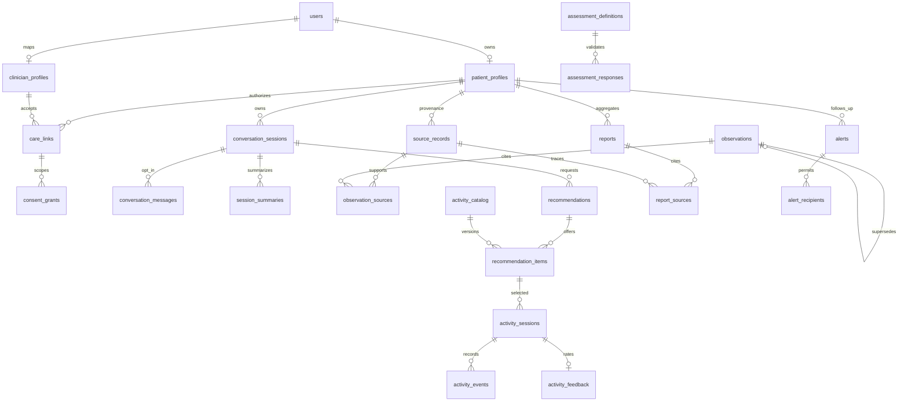

# RE:SONANCE — Database schema

Status: planning contract v2.0.0, 14 November 2026. Proposed; no application functionality is implemented. Fictional patient data only.

## Scope and authority

[database/schema.sql](../database/schema.sql) is an unapplied PostgreSQL 16+ baseline for private schema re. It creates 32 tables, checks, composite ownership FKs, indexes and comments in one transaction. No connection or migration was executed, and PostgreSQL executables are not installed in this environment. SQL execution/rollback and concurrency tests remain a first coding gate. This is an empty-database reference, not a safe upgrade script for populated data.

Supabase hosts identity separately. users.auth_subject maps JWT sub to users.id; there is no cross-database auth.users FK, auth.uid() policy, or assumption that Supabase RLS protects Tiger Data. PUBLIC receives no schema/table privileges. Deployment operator creates a non-owner runtime role and grants only required table operations, with INSERT/SELECT only for audit events; a separate migration owner applies DDL. No runtime credential is included.

UUIDv4 via built-in gen_random_uuid() is a documented exposed-ID/small-demo trade-off; no UUID extension is required. All times are timestamptz, numeric observations have explicit bounds, and bounded JSONB is limited to versioned configurations/state, instrument answers and report projections. Frequently joined ownership and state are typed relational columns, not arbitrary JSON.

## Entity relationships

Conceptual ERD omits secondary joins for readability; schema.sql is authoritative for every column and key.

## Table dictionary

A resource-specific DTO identifier maps to table id: session_id→conversation_sessions.id; observation_id→observations.id; recommendation_id→recommendations.id; activity_id→activity_catalog.id; activity_session_id→activity_sessions.id; feedback_id→activity_feedback.id; assessment_response_id→assessment_responses.id; report_id→reports.id; care_link_id→care_links.id; consent_grant_id→consent_grants.id; alert_id→alerts.id. DTO activity_version maps to activity_catalog.version and related activity_version columns. patient_id always maps to patient_profiles.patient_id, not an arbitrary external auth subject.

### re.users

Trusted role mapping; auth_subject is Supabase JWT sub, never user-editable role metadata.

| Column or constraint | SQL definition |
| --- | --- |
| id | `id uuid PRIMARY KEY DEFAULT gen_random_uuid()` |
| auth_subject | `auth_subject uuid NOT NULL UNIQUE` |
| role | `role text NOT NULL CHECK (role IN ('patient','clinician'))` |
| disabled_at | `disabled_at timestamptz` |
| created_at | `created_at timestamptz NOT NULL DEFAULT now()` |

### re.patient_profiles

Patient-owned profile; application validates IANA timezone and bounded preference/avatar keys.

| Column or constraint | SQL definition |
| --- | --- |
| patient_id | `patient_id uuid PRIMARY KEY REFERENCES re.users(id)` |
| display_name | `display_name text NOT NULL CHECK (length(display_name) BETWEEN 1 AND 160)` |
| timezone | `timezone text NOT NULL DEFAULT 'UTC'` |
| preferences | `preferences jsonb NOT NULL DEFAULT '{}'::jsonb` |
| CHECK | `CHECK (jsonb_typeof(preferences) = 'object')` |
| avatar | `avatar jsonb NOT NULL DEFAULT '{}'::jsonb` |
| CHECK | `CHECK (jsonb_typeof(avatar) = 'object')` |

### re.clinician_profiles

Manual verification only; no public endpoint can grant clinician role or verification.

| Column or constraint | SQL definition |
| --- | --- |
| clinician_id | `clinician_id uuid PRIMARY KEY REFERENCES re.users(id)` |
| display_name | `display_name text NOT NULL` |
| verified_at | `verified_at timestamptz` |
| verified_by | `verified_by uuid REFERENCES re.users(id)` |

### re.care_links

Patient creates invitation for a known verified clinician; target accepts. Re-invitation reuses the pair with audited state change.

| Column or constraint | SQL definition |
| --- | --- |
| id | `id uuid PRIMARY KEY DEFAULT gen_random_uuid()` |
| patient_id | `patient_id uuid NOT NULL REFERENCES re.patient_profiles(patient_id)` |
| clinician_id | `clinician_id uuid NOT NULL REFERENCES re.clinician_profiles(clinician_id)` |
| state | `state text NOT NULL CHECK (state IN ('pending','active','revoked'))` |
| created_at | `created_at timestamptz NOT NULL DEFAULT now()` |
| UNIQUE | `UNIQUE (id,patient_id)` |
| UNIQUE | `UNIQUE (patient_id,clinician_id)` |

### re.consent_grants

Retention consent is separate from doctor sharing. Never use a time-dependent partial index for expiry; compare now() in authorized reads.

| Column or constraint | SQL definition |
| --- | --- |
| id | `id uuid PRIMARY KEY DEFAULT gen_random_uuid()` |
| patient_id | `patient_id uuid NOT NULL REFERENCES re.patient_profiles(patient_id)` |
| care_link_id | `care_link_id uuid` |
| scope | `scope text NOT NULL CHECK (scope IN ('transcripts','reports','alerts'))` |
| expires_at | `expires_at timestamptz NOT NULL` |
| data_from | `data_from timestamptz` |
| revoked_at | `revoked_at timestamptz` |
| created_at | `created_at timestamptz NOT NULL DEFAULT now()` |
| UNIQUE | `UNIQUE (id,patient_id)` |
| FOREIGN | `FOREIGN KEY (care_link_id,patient_id) REFERENCES re.care_links(id,patient_id)` |
| CHECK | `CHECK ((scope = 'transcripts' AND care_link_id IS NULL AND data_from IS NULL) OR (scope IN ('reports','alerts') AND care_link_id IS NOT NULL))` |
| CHECK | `CHECK (expires_at > created_at)` |
| CHECK | `CHECK (revoked_at IS NULL OR revoked_at >= created_at)` |

### re.recovery_plans

Fictional plan context; not an autonomous treatment prescription.

| Column or constraint | SQL definition |
| --- | --- |
| id | `id uuid PRIMARY KEY DEFAULT gen_random_uuid()` |
| patient_id | `patient_id uuid NOT NULL REFERENCES re.patient_profiles(patient_id)` |
| version | `version integer NOT NULL CHECK (version > 0)` |
| title | `title text NOT NULL` |
| content | `content jsonb NOT NULL DEFAULT '{}'::jsonb` |
| CHECK | `CHECK (jsonb_typeof(content) = 'object')` |
| active | `active boolean NOT NULL DEFAULT true` |
| created_at | `created_at timestamptz NOT NULL DEFAULT now()` |

### re.conversation_sessions

Application state survives provider connections. Never store provider credentials or resumption handles here.

| Column or constraint | SQL definition |
| --- | --- |
| id | `id uuid PRIMARY KEY DEFAULT gen_random_uuid()` |
| patient_id | `patient_id uuid NOT NULL REFERENCES re.patient_profiles(patient_id)` |
| state | `state text NOT NULL CHECK (state IN ('created','active','interrupted','ended'))` |
| mode | `mode text NOT NULL CHECK (mode IN ('voice','text'))` |
| version | `version integer NOT NULL DEFAULT 1 CHECK (version > 0)` |
| guided_state | `guided_state jsonb NOT NULL DEFAULT '{}'::jsonb` |
| CHECK | `CHECK (jsonb_typeof(guided_state) = 'object')` |
| last_seen_at | `last_seen_at timestamptz NOT NULL DEFAULT now()` |
| ended_at | `ended_at timestamptz` |
| created_at | `created_at timestamptz NOT NULL DEFAULT now()` |
| UNIQUE | `UNIQUE (id,patient_id)` |
| CHECK | `CHECK ((state = 'ended') = (ended_at IS NOT NULL))` |

### re.provider_connections

V1 ElevenLabs transport epochs under one provider-independent application session. Opaque provider ID is not authority. Never store tokens, signed URLs, images, camera state or media. Future Gemini requires an explicit V2 schema revision.

| Column or constraint | SQL definition |
| --- | --- |
| id | `id uuid PRIMARY KEY DEFAULT gen_random_uuid()` |
| patient_id | `patient_id uuid NOT NULL REFERENCES re.patient_profiles(patient_id)` |
| session_id | `session_id uuid NOT NULL` |
| provider | `provider text NOT NULL CHECK (provider = 'elevenlabs')` |
| mode | `mode text NOT NULL CHECK (mode IN ('voice','text'))` |
| transport | `transport text NOT NULL CHECK (transport IN ('webrtc','websocket'))` |
| state | `state text NOT NULL CHECK (state IN ('created','connecting','active','interrupted','closed'))` |
| connection_epoch | `connection_epoch integer NOT NULL CHECK (connection_epoch > 0)` |
| context_version | `context_version integer NOT NULL CHECK (context_version > 0)` |
| version | `version integer NOT NULL DEFAULT 1 CHECK (version > 0)` |
| provider_conversation_id | `provider_conversation_id text` |
| connect_before | `connect_before timestamptz NOT NULL` |
| closed_at | `closed_at timestamptz` |
| created_at | `created_at timestamptz NOT NULL DEFAULT now()` |
| UNIQUE | `UNIQUE (id,patient_id)` |
| UNIQUE | `UNIQUE (id,session_id,connection_epoch,patient_id)` |
| UNIQUE | `UNIQUE (session_id,connection_epoch)` |
| FOREIGN | `FOREIGN KEY (session_id,patient_id) REFERENCES re.conversation_sessions(id,patient_id)` |
| CHECK | `CHECK ((mode = 'voice' AND transport = 'webrtc') OR (mode = 'text' AND transport = 'websocket'))` |
| CHECK | `CHECK ((state = 'closed') = (closed_at IS NOT NULL))` |

### re.source_records

Metadata only; no transcript excerpts, media or credentials. Entities point to a real same-patient source; tombstones mark deleted source availability.

| Column or constraint | SQL definition |
| --- | --- |
| id | `id uuid PRIMARY KEY DEFAULT gen_random_uuid()` |
| patient_id | `patient_id uuid NOT NULL REFERENCES re.patient_profiles(patient_id)` |
| kind | `kind text NOT NULL CHECK (kind IN ('transcript_turn','structured_input','activity_event','feedback','assessment','summary','correction'))` |
| session_id | `session_id uuid` |
| revision | `revision integer NOT NULL DEFAULT 1 CHECK (revision > 0)` |
| occurred_at | `occurred_at timestamptz NOT NULL` |
| unavailable_at | `unavailable_at timestamptz` |
| created_at | `created_at timestamptz NOT NULL DEFAULT now()` |
| UNIQUE | `UNIQUE (id,patient_id)` |
| UNIQUE | `UNIQUE (id,patient_id,revision)` |
| FOREIGN | `FOREIGN KEY (session_id,patient_id) REFERENCES re.conversation_sessions(id,patient_id)` |

### re.conversation_messages

Consent scope/active status requires locked transaction validation at ingestion. Reconcile partial events locally; only final/interrupted utterances accepted.

| Column or constraint | SQL definition |
| --- | --- |
| id | `id uuid PRIMARY KEY DEFAULT gen_random_uuid()` |
| patient_id | `patient_id uuid NOT NULL REFERENCES re.patient_profiles(patient_id)` |
| provider_connection_id | `provider_connection_id uuid NOT NULL` |
| session_id | `session_id uuid NOT NULL` |
| consent_grant_id | `consent_grant_id uuid NOT NULL` |
| source_id | `source_id uuid NOT NULL` |
| client_message_id | `client_message_id uuid NOT NULL` |
| turn_id | `turn_id text NOT NULL` |
| connection_epoch | `connection_epoch integer NOT NULL CHECK (connection_epoch > 0)` |
| sequence | `sequence integer NOT NULL CHECK (sequence > 0)` |
| speaker | `speaker text NOT NULL CHECK (speaker IN ('patient','assistant'))` |
| channel | `channel text NOT NULL CHECK (channel IN ('voice_transcription','typed_text'))` |
| text | `text text NOT NULL CHECK (length(text) BETWEEN 1 AND 8000)` |
| finality | `finality text NOT NULL CHECK (finality IN ('final','interrupted'))` |
| event_at | `event_at timestamptz NOT NULL` |
| created_at | `created_at timestamptz NOT NULL DEFAULT now()` |
| UNIQUE | `UNIQUE (id,patient_id)` |
| UNIQUE | `UNIQUE (session_id,client_message_id)` |
| UNIQUE | `UNIQUE (session_id,connection_epoch,sequence)` |
| FOREIGN | `FOREIGN KEY (provider_connection_id,session_id,connection_epoch,patient_id) REFERENCES re.provider_connections(id,session_id,connection_epoch,patient_id)` |
| FOREIGN | `FOREIGN KEY (session_id,patient_id) REFERENCES re.conversation_sessions(id,patient_id)` |
| FOREIGN | `FOREIGN KEY (consent_grant_id,patient_id) REFERENCES re.consent_grants(id,patient_id)` |
| FOREIGN | `FOREIGN KEY (source_id,patient_id) REFERENCES re.source_records(id,patient_id)` |

### re.session_summaries

Derived summary is not a confirmed fact. Without retention consent, use confirmed structured records only.

| Column or constraint | SQL definition |
| --- | --- |
| id | `id uuid PRIMARY KEY DEFAULT gen_random_uuid()` |
| patient_id | `patient_id uuid NOT NULL REFERENCES re.patient_profiles(patient_id)` |
| session_id | `session_id uuid NOT NULL` |
| version | `version integer NOT NULL CHECK (version > 0)` |
| basis | `basis text NOT NULL CHECK (basis IN ('consented_history','confirmed_records'))` |
| completeness | `completeness text NOT NULL CHECK (completeness IN ('complete','partial'))` |
| text | `text text NOT NULL CHECK (length(text) <= 4000)` |
| created_at | `created_at timestamptz NOT NULL DEFAULT now()` |
| UNIQUE | `UNIQUE (id,patient_id)` |
| UNIQUE | `UNIQUE (session_id,version)` |
| FOREIGN | `FOREIGN KEY (session_id,patient_id) REFERENCES re.conversation_sessions(id,patient_id)` |

### re.summary_sources

Normalized source lineage; unavailable text is not reconstructed from references.

| Column or constraint | SQL definition |
| --- | --- |
| summary_id | `summary_id uuid NOT NULL` |
| source_id | `source_id uuid NOT NULL` |
| patient_id | `patient_id uuid NOT NULL REFERENCES re.patient_profiles(patient_id)` |
| source_revision | `source_revision integer NOT NULL CHECK (source_revision > 0)` |
| PRIMARY | `PRIMARY KEY (summary_id,source_id,source_revision)` |
| FOREIGN | `FOREIGN KEY (summary_id,patient_id) REFERENCES re.session_summaries(id,patient_id)` |
| FOREIGN | `FOREIGN KEY (source_id,patient_id,source_revision) REFERENCES re.source_records(id,patient_id,revision)` |

### re.observations

Only current confirmed rows enter trends; corrections create a new row and supersede old head under a lock.

| Column or constraint | SQL definition |
| --- | --- |
| id | `id uuid PRIMARY KEY DEFAULT gen_random_uuid()` |
| patient_id | `patient_id uuid NOT NULL REFERENCES re.patient_profiles(patient_id)` |
| session_id | `session_id uuid` |
| kind | `kind text NOT NULL CHECK (kind IN ('mood','energy','sleep_hours'))` |
| value | `value numeric(5,2) NOT NULL` |
| observed_at | `observed_at timestamptz NOT NULL` |
| state | `state text NOT NULL CHECK (state IN ('proposed','confirmed','rejected','superseded'))` |
| version | `version integer NOT NULL DEFAULT 1 CHECK (version > 0)` |
| supersedes_observation_id | `supersedes_observation_id uuid` |
| confirmed_at | `confirmed_at timestamptz` |
| created_at | `created_at timestamptz NOT NULL DEFAULT now()` |
| UNIQUE | `UNIQUE (id,patient_id)` |
| FOREIGN | `FOREIGN KEY (session_id,patient_id) REFERENCES re.conversation_sessions(id,patient_id)` |
| FOREIGN | `FOREIGN KEY (supersedes_observation_id,patient_id) REFERENCES re.observations(id,patient_id)` |
| CHECK | `CHECK ((kind IN ('mood','energy') AND value BETWEEN 0 AND 10) OR (kind = 'sleep_hours' AND value BETWEEN 0 AND 24))` |
| CHECK | `CHECK (state NOT IN ('confirmed','superseded') OR confirmed_at IS NOT NULL)` |
| CHECK | `CHECK (supersedes_observation_id IS NULL OR supersedes_observation_id <> id)` |

### re.observation_sources

References explicit structured input, correction event, or a consented patient utterance; no assistant speech evidence.

| Column or constraint | SQL definition |
| --- | --- |
| observation_id | `observation_id uuid NOT NULL` |
| source_id | `source_id uuid NOT NULL` |
| patient_id | `patient_id uuid NOT NULL REFERENCES re.patient_profiles(patient_id)` |
| source_revision | `source_revision integer NOT NULL CHECK (source_revision > 0)` |
| PRIMARY | `PRIMARY KEY (observation_id,source_id,source_revision)` |
| FOREIGN | `FOREIGN KEY (observation_id,patient_id) REFERENCES re.observations(id,patient_id)` |
| FOREIGN | `FOREIGN KEY (source_id,patient_id,source_revision) REFERENCES re.source_records(id,patient_id,revision)` |

### re.patient_memories

Explicitly patient-confirmed preferences. No model-authorized memory mutation.

| Column or constraint | SQL definition |
| --- | --- |
| id | `id uuid PRIMARY KEY DEFAULT gen_random_uuid()` |
| patient_id | `patient_id uuid NOT NULL REFERENCES re.patient_profiles(patient_id)` |
| key | `key text NOT NULL CHECK (key IN ('preferred_activity_kind','preferred_duration_seconds'))` |
| value | `value jsonb NOT NULL` |
| CHECK | `CHECK (jsonb_typeof(value) = 'object')` |
| source_id | `source_id uuid NOT NULL` |
| created_at | `created_at timestamptz NOT NULL DEFAULT now()` |
| UNIQUE | `UNIQUE (patient_id,key)` |
| FOREIGN | `FOREIGN KEY (source_id,patient_id) REFERENCES re.source_records(id,patient_id)` |

### re.activity_catalog

Immutable versioned catalog rows. Config keys/assets allowlisted; no arbitrary model-generated script or URL.

| Column or constraint | SQL definition |
| --- | --- |
| id | `id uuid PRIMARY KEY DEFAULT gen_random_uuid()` |
| slug | `slug text NOT NULL` |
| version | `version integer NOT NULL CHECK (version > 0)` |
| kind | `kind text NOT NULL CHECK (kind IN ('breathing','nature','behavioral_activation','reflection','social_reconnection'))` |
| title | `title text NOT NULL` |
| description | `description text NOT NULL` |
| duration_seconds | `duration_seconds integer NOT NULL CHECK (duration_seconds BETWEEN 30 AND 1800)` |
| config | `config jsonb NOT NULL DEFAULT '{}'::jsonb` |
| CHECK | `CHECK (jsonb_typeof(config) = 'object')` |
| active | `active boolean NOT NULL DEFAULT true` |
| UNIQUE | `UNIQUE (id,version)` |
| UNIQUE | `UNIQUE (slug,version)` |

### re.recommendations

Current recommendation is latest created_at/id for that session; selection rechecks this and expiry/eligibility.

| Column or constraint | SQL definition |
| --- | --- |
| id | `id uuid PRIMARY KEY DEFAULT gen_random_uuid()` |
| patient_id | `patient_id uuid NOT NULL REFERENCES re.patient_profiles(patient_id)` |
| session_id | `session_id uuid NOT NULL` |
| expires_at | `expires_at timestamptz NOT NULL` |
| created_at | `created_at timestamptz NOT NULL DEFAULT now()` |
| UNIQUE | `UNIQUE (id,patient_id)` |
| FOREIGN | `FOREIGN KEY (session_id,patient_id) REFERENCES re.conversation_sessions(id,patient_id)` |
| CHECK | `CHECK (expires_at > created_at)` |

### re.recommendation_items

Exact option IDs and order used for both visible cards and speech.

| Column or constraint | SQL definition |
| --- | --- |
| recommendation_id | `recommendation_id uuid NOT NULL` |
| patient_id | `patient_id uuid NOT NULL REFERENCES re.patient_profiles(patient_id)` |
| activity_id | `activity_id uuid NOT NULL` |
| activity_version | `activity_version integer NOT NULL` |
| rank | `rank integer NOT NULL CHECK (rank BETWEEN 1 AND 3)` |
| reason | `reason text NOT NULL` |
| PRIMARY | `PRIMARY KEY (recommendation_id,activity_id)` |
| UNIQUE | `UNIQUE (recommendation_id,rank)` |
| UNIQUE | `UNIQUE (recommendation_id,activity_id,patient_id)` |
| FOREIGN | `FOREIGN KEY (recommendation_id,patient_id) REFERENCES re.recommendations(id,patient_id)` |
| FOREIGN | `FOREIGN KEY (activity_id,activity_version) REFERENCES re.activity_catalog(id,version)` |

### re.activity_sessions

Backend additionally checks recommendation session and offered version match. One active activity per conversation, enforced below.

| Column or constraint | SQL definition |
| --- | --- |
| id | `id uuid PRIMARY KEY DEFAULT gen_random_uuid()` |
| patient_id | `patient_id uuid NOT NULL REFERENCES re.patient_profiles(patient_id)` |
| session_id | `session_id uuid NOT NULL` |
| recommendation_id | `recommendation_id uuid NOT NULL` |
| activity_id | `activity_id uuid NOT NULL` |
| activity_version | `activity_version integer NOT NULL` |
| selection_channel | `selection_channel text NOT NULL CHECK (selection_channel IN ('voice','touch'))` |
| state | `state text NOT NULL CHECK (state IN ('started','completed','abandoned'))` |
| version | `version integer NOT NULL DEFAULT 1 CHECK (version > 0)` |
| started_at | `started_at timestamptz NOT NULL DEFAULT now()` |
| ended_at | `ended_at timestamptz` |
| UNIQUE | `UNIQUE (id,patient_id)` |
| FOREIGN | `FOREIGN KEY (session_id,patient_id) REFERENCES re.conversation_sessions(id,patient_id)` |
| FOREIGN | `FOREIGN KEY (recommendation_id,activity_id,patient_id) REFERENCES re.recommendation_items(recommendation_id,activity_id,patient_id)` |
| FOREIGN | `FOREIGN KEY (activity_id,activity_version) REFERENCES re.activity_catalog(id,version)` |
| CHECK | `CHECK ((state = 'started') = (ended_at IS NULL))` |
| CHECK | `CHECK (ended_at IS NULL OR ended_at >= started_at)` |

### re.activity_events

Events are reported by client, not physiological verification; terminal transitions checked under activity row lock.

| Column or constraint | SQL definition |
| --- | --- |
| id | `id uuid PRIMARY KEY DEFAULT gen_random_uuid()` |
| patient_id | `patient_id uuid NOT NULL REFERENCES re.patient_profiles(patient_id)` |
| activity_session_id | `activity_session_id uuid NOT NULL` |
| client_event_id | `client_event_id uuid NOT NULL` |
| source_id | `source_id uuid NOT NULL` |
| event_type | `event_type text NOT NULL CHECK (event_type IN ('progress','complete','abandon'))` |
| elapsed_seconds | `elapsed_seconds integer NOT NULL CHECK (elapsed_seconds BETWEEN 0 AND 7200)` |
| event_at | `event_at timestamptz NOT NULL` |
| created_at | `created_at timestamptz NOT NULL DEFAULT now()` |
| UNIQUE | `UNIQUE (activity_session_id,client_event_id)` |
| FOREIGN | `FOREIGN KEY (activity_session_id,patient_id) REFERENCES re.activity_sessions(id,patient_id)` |
| FOREIGN | `FOREIGN KEY (source_id,patient_id) REFERENCES re.source_records(id,patient_id)` |

### re.activity_feedback

Only completed activity accepts feedback; backend rule. Comments are patient data, not transcript history.

| Column or constraint | SQL definition |
| --- | --- |
| id | `id uuid PRIMARY KEY DEFAULT gen_random_uuid()` |
| patient_id | `patient_id uuid NOT NULL REFERENCES re.patient_profiles(patient_id)` |
| activity_session_id | `activity_session_id uuid NOT NULL UNIQUE` |
| source_id | `source_id uuid NOT NULL` |
| rating | `rating integer NOT NULL CHECK (rating BETWEEN 1 AND 5)` |
| comment | `comment text CHECK (length(comment) <= 1000)` |
| created_at | `created_at timestamptz NOT NULL DEFAULT now()` |
| UNIQUE | `UNIQUE (id,patient_id)` |
| FOREIGN | `FOREIGN KEY (activity_session_id,patient_id) REFERENCES re.activity_sessions(id,patient_id)` |
| FOREIGN | `FOREIGN KEY (source_id,patient_id) REFERENCES re.source_records(id,patient_id)` |

### re.assessment_definitions

MVP fictional nonclinical wellbeing check-in. No licensed or diagnostic instrument assumed.

| Column or constraint | SQL definition |
| --- | --- |
| id | `id uuid PRIMARY KEY DEFAULT gen_random_uuid()` |
| version | `version integer NOT NULL CHECK (version > 0)` |
| title | `title text NOT NULL` |
| clinical_instrument | `clinical_instrument boolean NOT NULL DEFAULT false CHECK (clinical_instrument = false)` |
| questions | `questions jsonb NOT NULL CHECK (jsonb_typeof(questions) = 'array')` |
| UNIQUE | `UNIQUE (id,version)` |

### re.assessment_responses

Backend validates exact question IDs, uniqueness, bounds and completeness against pinned version.

| Column or constraint | SQL definition |
| --- | --- |
| id | `id uuid PRIMARY KEY DEFAULT gen_random_uuid()` |
| patient_id | `patient_id uuid NOT NULL REFERENCES re.patient_profiles(patient_id)` |
| session_id | `session_id uuid` |
| assessment_id | `assessment_id uuid NOT NULL` |
| assessment_version | `assessment_version integer NOT NULL` |
| source_id | `source_id uuid NOT NULL` |
| answers | `answers jsonb NOT NULL CHECK (jsonb_typeof(answers) = 'array')` |
| complete | `complete boolean NOT NULL` |
| observed_at | `observed_at timestamptz NOT NULL` |
| created_at | `created_at timestamptz NOT NULL DEFAULT now()` |
| UNIQUE | `UNIQUE (id,patient_id)` |
| FOREIGN | `FOREIGN KEY (session_id,patient_id) REFERENCES re.conversation_sessions(id,patient_id)` |
| FOREIGN | `FOREIGN KEY (assessment_id,assessment_version) REFERENCES re.assessment_definitions(id,version)` |
| FOREIGN | `FOREIGN KEY (source_id,patient_id) REFERENCES re.source_records(id,patient_id)` |

### re.reports

Current versioned projection; refresh atomically increments version. Source revisions retained, prior generation metadata audited; no claim that old report payloads are archived.

| Column or constraint | SQL definition |
| --- | --- |
| id | `id uuid PRIMARY KEY DEFAULT gen_random_uuid()` |
| patient_id | `patient_id uuid NOT NULL REFERENCES re.patient_profiles(patient_id)` |
| version | `version integer NOT NULL DEFAULT 1 CHECK (version > 0)` |
| calculation_version | `calculation_version text NOT NULL` |
| period_start | `period_start timestamptz NOT NULL` |
| period_end | `period_end timestamptz NOT NULL` |
| state | `state text NOT NULL CHECK (state IN ('pending','ready','stale','failed'))` |
| generated_at | `generated_at timestamptz` |
| data_cutoff | `data_cutoff timestamptz` |
| payload | `payload jsonb` |
| created_at | `created_at timestamptz NOT NULL DEFAULT now()` |
| UNIQUE | `UNIQUE (id,patient_id)` |
| CHECK | `CHECK (period_end > period_start)` |
| CHECK | `CHECK (state NOT IN ('ready','stale') OR (payload IS NOT NULL AND jsonb_typeof(payload) = 'object' AND generated_at IS NOT NULL AND data_cutoff IS NOT NULL))` |

### re.report_sources

Report grant does not expose private source bodies; return IDs/availability and only permitted structured content.

| Column or constraint | SQL definition |
| --- | --- |
| report_id | `report_id uuid NOT NULL` |
| source_id | `source_id uuid NOT NULL` |
| patient_id | `patient_id uuid NOT NULL REFERENCES re.patient_profiles(patient_id)` |
| source_revision | `source_revision integer NOT NULL CHECK (source_revision > 0)` |
| PRIMARY | `PRIMARY KEY (report_id,source_id,source_revision)` |
| FOREIGN | `FOREIGN KEY (report_id,patient_id) REFERENCES re.reports(id,patient_id)` |
| FOREIGN | `FOREIGN KEY (source_id,patient_id,source_revision) REFERENCES re.source_records(id,patient_id,revision)` |

### re.alert_rules

Only patient_requested_review enabled for MVP; clinical thresholds remain unapproved and disabled.

| Column or constraint | SQL definition |
| --- | --- |
| rule_key | `rule_key text NOT NULL` |
| version | `version integer NOT NULL CHECK (version > 0)` |
| enabled | `enabled boolean NOT NULL DEFAULT false` |
| definition | `definition jsonb NOT NULL` |
| CHECK | `CHECK (jsonb_typeof(definition) = 'object')` |
| PRIMARY | `PRIMARY KEY (rule_key,version)` |

### re.alerts

Source IDs are validated against same-patient source_records before use. No notification equals read acknowledgement.

| Column or constraint | SQL definition |
| --- | --- |
| id | `id uuid PRIMARY KEY DEFAULT gen_random_uuid()` |
| patient_id | `patient_id uuid NOT NULL REFERENCES re.patient_profiles(patient_id)` |
| session_id | `session_id uuid` |
| rule_key | `rule_key text NOT NULL` |
| rule_version | `rule_version integer NOT NULL` |
| dedup_key | `dedup_key text NOT NULL` |
| state | `state text NOT NULL CHECK (state IN ('open','acknowledged','resolved'))` |
| version | `version integer NOT NULL DEFAULT 1 CHECK (version > 0)` |
| source_ids | `source_ids jsonb NOT NULL DEFAULT '[]'::jsonb CHECK (jsonb_typeof(source_ids) = 'array')` |
| created_at | `created_at timestamptz NOT NULL DEFAULT now()` |
| UNIQUE | `UNIQUE (id,patient_id)` |
| UNIQUE | `UNIQUE (patient_id,rule_key,dedup_key)` |
| FOREIGN | `FOREIGN KEY (session_id,patient_id) REFERENCES re.conversation_sessions(id,patient_id)` |
| FOREIGN | `FOREIGN KEY (rule_key,rule_version) REFERENCES re.alert_rules(rule_key,version)` |

### re.alert_recipients

Revalidate active link and alerts grant before visibility and reads; suppress after revocation.

| Column or constraint | SQL definition |
| --- | --- |
| alert_id | `alert_id uuid NOT NULL` |
| patient_id | `patient_id uuid NOT NULL REFERENCES re.patient_profiles(patient_id)` |
| care_link_id | `care_link_id uuid NOT NULL` |
| consent_grant_id | `consent_grant_id uuid NOT NULL` |
| delivery_state | `delivery_state text NOT NULL CHECK (delivery_state IN ('pending','visible','suppressed'))` |
| acknowledged_at | `acknowledged_at timestamptz` |
| PRIMARY | `PRIMARY KEY (alert_id,care_link_id)` |
| FOREIGN | `FOREIGN KEY (alert_id,patient_id) REFERENCES re.alerts(id,patient_id)` |
| FOREIGN | `FOREIGN KEY (care_link_id,patient_id) REFERENCES re.care_links(id,patient_id)` |
| FOREIGN | `FOREIGN KEY (consent_grant_id,patient_id) REFERENCES re.consent_grants(id,patient_id)` |

### re.audit_events

Append-only access/change metadata; no transcripts, values, credentials or report JSON. Runtime lacks UPDATE/DELETE on this table.

| Column or constraint | SQL definition |
| --- | --- |
| id | `id uuid PRIMARY KEY DEFAULT gen_random_uuid()` |
| actor_id | `actor_id uuid REFERENCES re.users(id)` |
| patient_id | `patient_id uuid REFERENCES re.patient_profiles(patient_id)` |
| action | `action text NOT NULL` |
| resource_type | `resource_type text NOT NULL` |
| resource_id | `resource_id uuid` |
| request_id | `request_id uuid NOT NULL` |
| created_at | `created_at timestamptz NOT NULL DEFAULT now()` |

### re.idempotency_keys

Never persist provider credential responses; separate bounded ephemeral cache. Reauthorize before replay; sanitize/remove transcript bodies and private data upon retention changes.

| Column or constraint | SQL definition |
| --- | --- |
| actor_id | `actor_id uuid NOT NULL REFERENCES re.users(id)` |
| method | `method text NOT NULL` |
| route | `route text NOT NULL` |
| key | `key uuid NOT NULL` |
| request_hash | `request_hash text NOT NULL` |
| response_status | `response_status integer NOT NULL CHECK (response_status BETWEEN 200 AND 599)` |
| response_body | `response_body jsonb` |
| expires_at | `expires_at timestamptz NOT NULL` |
| created_at | `created_at timestamptz NOT NULL DEFAULT now()` |
| PRIMARY | `PRIMARY KEY (actor_id,method,route,key)` |

### re.tool_calls

Allowlisted name and typed args validated in service. Store sanitized resource references; never arbitrary prompt/tool payload logs.

| Column or constraint | SQL definition |
| --- | --- |
| id | `id uuid PRIMARY KEY DEFAULT gen_random_uuid()` |
| patient_id | `patient_id uuid NOT NULL REFERENCES re.patient_profiles(patient_id)` |
| provider_connection_id | `provider_connection_id uuid NOT NULL` |
| session_id | `session_id uuid NOT NULL` |
| tool_call_id | `tool_call_id text NOT NULL` |
| tool_name | `tool_name text NOT NULL` |
| contract_version | `contract_version text NOT NULL` |
| request_hash | `request_hash text NOT NULL` |
| result_resource_id | `result_resource_id uuid` |
| outcome_code | `outcome_code text NOT NULL` |
| created_at | `created_at timestamptz NOT NULL DEFAULT now()` |
| UNIQUE | `UNIQUE (provider_connection_id,tool_call_id)` |
| FOREIGN | `FOREIGN KEY (provider_connection_id,patient_id) REFERENCES re.provider_connections(id,patient_id)` |
| FOREIGN | `FOREIGN KEY (session_id,patient_id) REFERENCES re.conversation_sessions(id,patient_id)` |

### re.outbox_jobs

Commit with accepted write. Claim with SKIP LOCKED, fenced lease token and idempotent handlers; resource IDs only, no transcript payload copies.

| Column or constraint | SQL definition |
| --- | --- |
| id | `id uuid PRIMARY KEY DEFAULT gen_random_uuid()` |
| patient_id | `patient_id uuid NOT NULL REFERENCES re.patient_profiles(patient_id)` |
| event_key | `event_key text NOT NULL UNIQUE` |
| kind | `kind text NOT NULL CHECK (kind IN ('report_refresh','alert_delivery','session_summary','retention_cleanup'))` |
| resource_id | `resource_id uuid NOT NULL` |
| state | `state text NOT NULL DEFAULT 'pending' CHECK (state IN ('pending','running','done','failed'))` |
| attempts | `attempts integer NOT NULL DEFAULT 0 CHECK (attempts >= 0)` |
| available_at | `available_at timestamptz NOT NULL DEFAULT now()` |
| lease_until | `lease_until timestamptz` |
| lease_token | `lease_token uuid` |
| last_error_code | `last_error_code text` |
| created_at | `created_at timestamptz NOT NULL DEFAULT now()` |

## Ownership and constraints

Composite (record_id,patient_id) FKs reject cross-patient references for sessions, transcripts, observations, links, grants, activities and report lineage. Source junctions also FK source_revision to the immutable source revision key. Other response SourceRef values are resolved/validated against the source record by application services. No polymorphic arbitrary-record lookup is authorized solely from an ID. Source records contain provenance metadata only, with unavailable_at tombstones; sensitive bodies remain in their owning table.

Rows with same-patient FKs still need semantic checks: active grant scope/expiry, user role matching its profile type, recommendation session/offered version/current status, assessment answer schema, permitted state transitions and source kind. These cannot be implemented as cross-row CHECK constraints; services enforce them under explicit transaction/locking rules. The SQL comments list these rules rather than falsely promising DB enforcement.

Corrections: lock observation head and verify expected_version; insert a correction source/new confirmed observation; set original superseded; unique non-null supersedes_observation_id prevents branches; invalidate report state and add outbox event in the same UoW. Store reasons in protected source/application records as needed; audit metadata contains no value or transcript text. Source revision rows are immutable after acceptance; deletion marks availability rather than inventing content.

reports stores the current versioned projection, with source revisions in report_sources. Recompute under a report lock, replace payload/source links atomically and increment version. Prior generation metadata is audited; old payloads are not promised as an archive. Report JSON field names follow the canonical Report DTO. Only current confirmed observation heads enter calculations; historical superseded records remain for lineage.

## Index and transaction strategy

FK indexes are generated unless an existing PK/unique left-prefix covers them. Composite ownership indexes are intentional; do not remove them simply because the parent ID is a UUID. Additional indexes support confirmed observations by patient/time, message order, current recommendation lookup, report period, unrevoked grant lookup, current observation successor uniqueness, one running activity per conversation, job claims/expired leases and idempotency expiry. Check plans and remove truly redundant indexes only against representative queries, not assumptions.

Avoid now() in partial index predicates; use static state/revoked_at predicates and compare expiry at query time. Proposed authorization lookup takes current users/verified role, active care link, matching patient/scope, revoked_at IS NULL and expires_at > now(). New grant retires any prior unrevoked grant for that patient/link/scope in one transaction before insert; revoking a current grant must not leave another parallel grant authorizing access.

Claim jobs with SELECT ... FOR UPDATE SKIP LOCKED, bounded batch, then persist running state, attempts, lease_until and a fresh lease_token in a short transaction. Execute outside the claim transaction. Finish only if lease token still matches; expired claims can be reclaimed. Event keys and business uniqueness make at-least-once work idempotent. Failed attempts store a machine error code, never a prompt/transcript payload. Optional job runner is part of the same Python application, not a new microservice.

Use one async session per concurrent use case; bound pool size per process against managed DB limits. Keep report calculations scoped to patient/time indexes. Do not keep a DB transaction open for a voice connection or provider HTTP call. Reserve idempotency identity before external provisioning and finalize sanitized outcome separately; reconcile interrupted provisioning without persisting secrets.

## Retention and revocation

Proposed fictional-demo retention assumptions: consented transcripts 24h, idempotency metadata 24h, all fictional demo records removed within 7 days after judging. These are cleanup targets requiring a configured runner and deletion verification, not legal/clinical retention rules. No real patient rollout without approved regional/retention policy. History grant revocation stops future ingestion, clears queued device text and denies replays; deletion of prior text is separate from sharing revocation. Doctor sharing revocation blocks future reads/visibility but does not delete the patient's own records.

Cleanup deletes sensitive bodies in FK-safe order, marks source availability, refreshes affected summaries/reports to remove private quotations, and purges any sensitive cached response. Source references and correction lineage never authorize reading a removed body. Remove expired provider credentials only from transient caches. Audit retention and backups require an explicit operator policy before real data; do not claim instant erasure from backups.

## Migration plan (not performed)

1. Developer 3 verifies managed PostgreSQL major/version and creates a disposable database; capture baseline SQL execution and introspection before writing ORM models.
2. Propose Alembic migrations in phases: identity/links/grants → sessions/sources/observations → catalog/recommendations/activity/assessments → reports/alerts/audit/idempotency/outbox. No migrations exist yet. Final empty-database state must match schema.sql; no automatic destructive diff against managed data.
3. Add fictional seed data separately, with fixed stable IDs and no credentials in source. At least two patients, verified/unverified clinicians, all five activity kinds and one nonclinical assessment.
4. Test upgrade from empty and prior stage, transaction rollback on failure, cross-patient FKs, bounds, index existence, two concurrent completions/corrections/grants, and job lease fencing.
5. Separate runtime/migration roles; grant only required DML, test no DDL/audit mutation privileges. Application row authorization remains mandatory; RLS is a future defense-in-depth decision, not an undocumented promise.
6. Review generated migrations and backup/restore plan before a shared database change. This package executes none of these actions.

### Confirmation versus later correction

If the patient edits a proposal while confirming it, keep the original proposed row as rejected and create a new confirmed observation referencing that proposal via supersedes_observation_id. This preserves extraction provenance without falsely marking an unconfirmed row as previously confirmed. A later correction of a confirmed row changes its state to superseded and inserts the corrected confirmed head. Both operations are transactional and return the accepted observation ID; duplicate confirmation retries replay the same accepted identity.

## Provider connection mapping

An application conversation can have successive voice/text provider_connections. API connection_id maps to provider_connections.id; Message.connection_id and ToolDispatch.connection_id map to provider_connection_id. Epoch and ownership are checked against the session. One open connection per session prevents simultaneous conflicting provider context. current_connection_id is computed, not an extra sessions column. Provider-native IDs are metadata, not credentials or authorization. Credentials and camera state never enter SQL. V1 provider constraint is ElevenLabs; a future Gemini migration requires explicit schema and consent changes.
