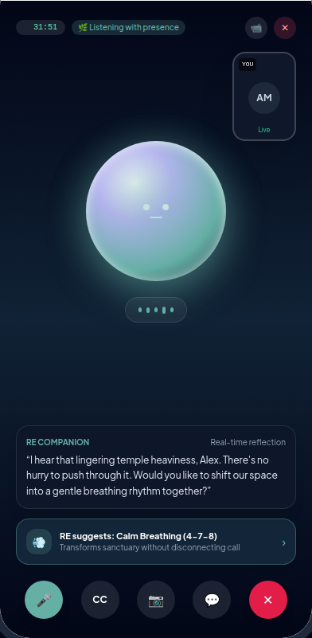
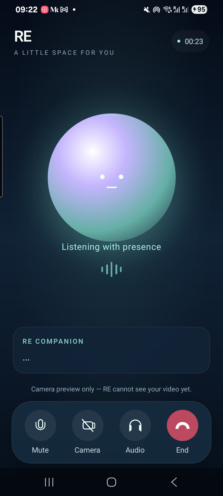
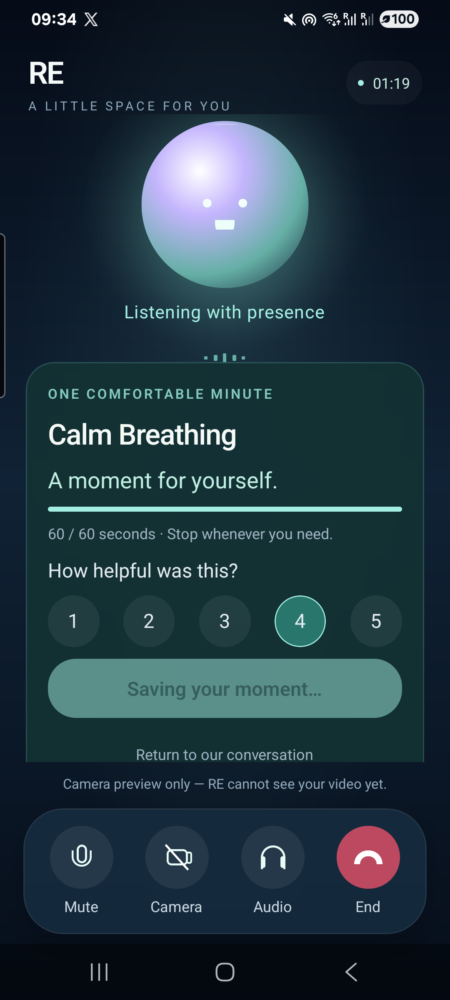
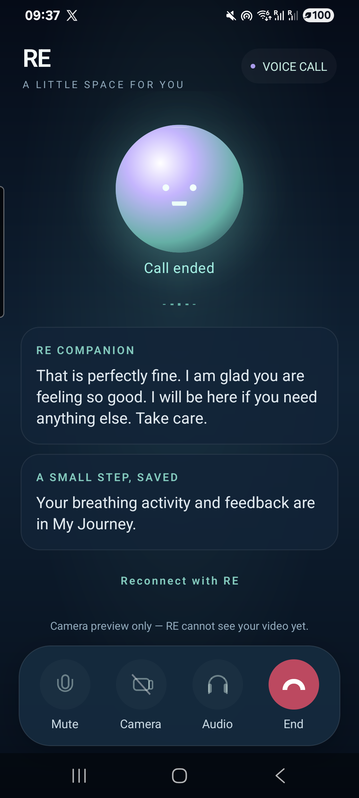

# Native call experience review — 14 November 2026

## Reference and differences identified before edits

Read `docs/design/DESIGN.md`, the voice-call markup/styles/state handlers in `docs/design/code.html`, the original `screen.png`, and `docs/FRONTEND_SPEC.md`. The original assets are preserved. The screenshot shows the welcome screen; the HTML is the source for the intended call composition. A rendered voice reference is in [stitch-voice.png](implementation-validation/native-call/stitch-voice.png).

| Stitch reference | Previous native implementation | Refactor |
| --- | --- | --- |
| Dark navy full-screen call with atmospheric teal/lavender light | General ivory scrolling page, shared navigation/configuration labels | Dedicated safe-area-aware call composition |
| Living orb with face, halo, listening/thinking/speaking states | Static circle and placeholder label | Native gradient/transform fallback with actual adapter events and optional RMS metering |
| Small top-right camera PiP, companion remains present | Separate preview rectangle below orb | Local-only PiP in the call stage |
| Compact persistent controls | Oversized mute/end buttons among page content | 54 dp mute, camera, audio, end controls above system insets |
| Activity transforms the sanctuary without disconnecting | Separate activity page removes call controls | Same mounted call component renders activity panel; provider remains mounted |

No original `.riv`, font files, or original animated character files were found. The fallback recreates the HTML orb geometry and palette, not an original Rive character. System typography remains a difference from the prototype's remotely loaded Plus Jakarta Sans/Manrope. No generated artwork or new native runtime was added.

## Boundaries

- Existing Python Conversation Controller, authenticated bootstrap, contracts, Mobile UI Bridge, PostgreSQL and report APIs remain authoritative.
- `VoiceAgentAdapter` adds provider-independent state/audio-level events. Speaking comes from playback mode, not assistant text. RMS readings remain ephemeral; no audio recording is introduced.
- `audio-session.native.ts` requests microphone and (Android 12+) nearby-device access independently of camera. SDK owns session start/detach and communication audio focus. App backgrounding pauses microphone until explicit unmute.
- `use-local-camera.ts` is independent of adapter/route state. Camera defaults off; only toggle requests permission. Unmount/disable/background/call end releases the preview. There are no capture methods, frame callbacks, recordings, uploads or provider track inputs.
- `use-audio-routes.ts` uses public LiveKit `getAudioOutputs`/`selectAudioOutput` after connection. Native AudioSwitch monitors devices; availability is polled at 1 Hz because this installed public JS API exposes no current-selected-route/device-change event. Automatic mode reapplies preference on device-list changes; explicit unavailable choices fall back to automatic. UI indicates requested selection, not independently verified input routing.
- Companion transforms/opacity run on the native animation driver. No per-frame React state changes; RMS is sampled at 100 ms and consumed locally. Reduced motion removes orb movement and audio-driven facial scaling.
- Activity selection still uses exact backend recommendation/activity/version IDs. The bridge resolves only after committed cards. Completion and feedback keep existing idempotency keys and refresh My Journey before showing saved state. No recommendation logic moved into the app.

## Reproducible SDK fix

Installed `@elevenlabs/react-native` **1.2.40** contains `preferredOutputList: ["speaker"]` in `dist/index.react-native.js`, matching [upstream issue #881](https://github.com/elevenlabs/packages/issues/881). Configuring before SDK startup would be overwritten. `mobile/scripts/patch-elevenlabs.mjs` runs on npm postinstall, checks the exact SDK version and expected replacement, and changes the list at the SDK's own lifecycle point to Bluetooth → wired headset → speaker → earpiece. Communication preset and SDK cleanup stay intact. `npm ci` and CI apply it reproducibly; changes to the pinned SDK require patch review. No native dependency versions were upgraded.

LiveKit's installed Android audio manager requests/abandons focus and uses voice communication mode, but its default focus-change callback is empty and no public JS interruption callback is exposed. AppState interruption handling is implemented; telephony/audio-focus behavior still requires real-device testing. No undocumented native override or independent microphone-selection claim is made.

## Verification

See [IMPLEMENTATION_STATUS.md](IMPLEMENTATION_STATUS.md) for actual results and remaining blockers. Screenshots must be captured with local camera preview disabled; no camera imagery or voice recordings are captured. UI screenshots can contain RE’s visible captions.

## Screenshot comparison

These are real screenshots, not mockups. The reference is the original HTML voice screen; Android images were captured with camera preview off. The activity screenshot includes the real save-in-progress state; a subsequent database receipt and saved-call screenshot verify completion. Device status-bar icons belong to Android.

| Original Stitch call | Android native call | Android activity overlay | Saved result in call |
| --- | --- | --- | --- |
|  |  |  |  |

Compared visually on the phone: navy atmosphere, teal/lavender living orb and face, compact rounded cards, and persistent bottom controls now follow the reference. PiP location was checked in the native view tree and actual camera service, without capturing camera imagery. Android uses four required controls instead of the prototype's extra captions/text shortcuts. System fonts and native radial-gradient rendering remain visual differences. No original Rive character or measured release-performance result is claimed.

## Files changed in this refactor

- `mobile/App.tsx`: dedicated call composition branch; adapter events; mic-only startup; cancellation cleanup; seamless activity save/return; removes patient-facing provider/placeholder/Working labels. Existing authentication, bootstrap, bridge and persistence paths retained.
- `mobile/src/features/call/call-screen.tsx`: full-screen composition, safe areas, cards/activity/feedback, resume/reconnect controls and route selector.
- `mobile/src/features/call/call-controls.tsx`: fixed accessible compact toolbar and drawn control icons.
- `mobile/src/features/call/companion.tsx`: native gradient orb fallback, actual audio-level response, reduced-motion support.
- `mobile/src/features/call/call-state.ts`: provider-independent state reducer and route preference.
- `mobile/src/features/call/audio-session.ts`, `audio-session.native.ts`: platform boundary; independent microphone/Bluetooth permissions; public LiveKit outputs/session release.
- `mobile/src/features/call/use-audio-routes.ts`: native availability refresh, user selection, automatic hotplug fallback and cleanup.
- `mobile/src/features/call/use-local-camera.ts`: independent local preview lifetime, permission-dialog handling, background/end cleanup.
- `mobile/src/integration/eleven-provider.tsx`, `voice-agent-adapter.ts`: real mode/interruption/metering events and cancellation of pending connection waits; text audio-control regression safeguards preserved.
- `mobile/src/features/reports/reports-sharing.tsx`: removes one stray JSX text node exposed by native testing; report behavior unchanged.
- `mobile/scripts/patch-elevenlabs.mjs`, `mobile/package.json`, `mobile/package-lock.json`: guarded reproducible postinstall route patch, exact existing SDK pin and test command.
- `mobile/app.json`: declared microphone and Android Bluetooth-connect permissions; no new native dependency version.
- `mobile/tests/call.test.ts`, `mobile/tests/run.ts`: event/route/cancellation/installed-patch/privacy-boundary checks plus existing bridge regressions.
- `mobile/README.md`, `docs/FRONTEND_SPEC.md`, `docs/IMPLEMENTATION_STATUS.md`, this review, `docs/DEVICE_VERIFICATION.md`, and `docs/implementation-validation/native-call/`: setup, comparison and actual evidence/limitations.

No backend source, wire contract, database migration, original Stitch asset or Gemini architecture decision was changed. Existing unrelated working-tree changes are preserved. The patch mechanism is supplied as repository source; this session did not create a separate Git commit.
