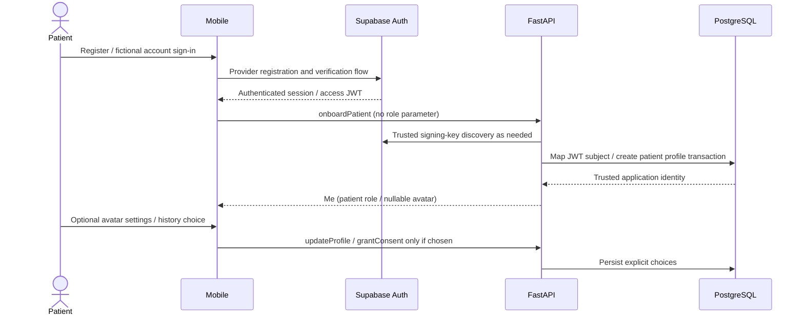
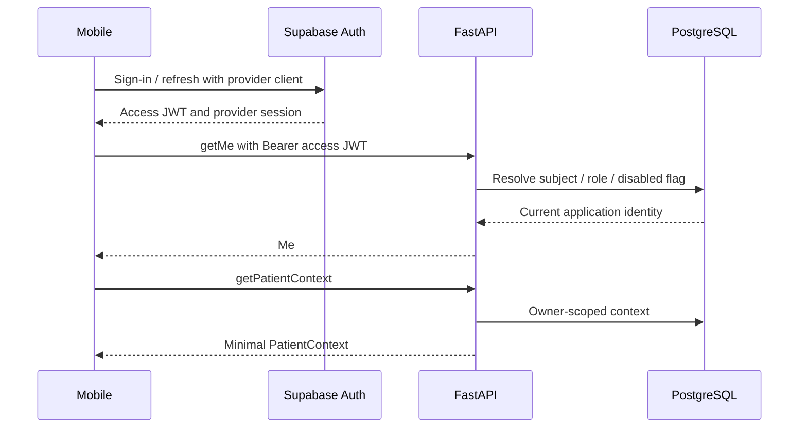
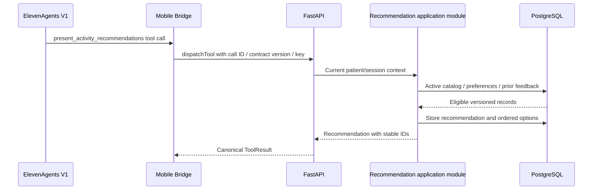
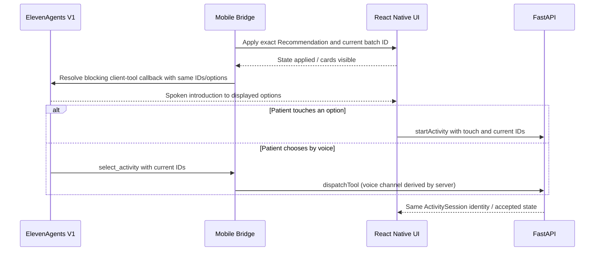
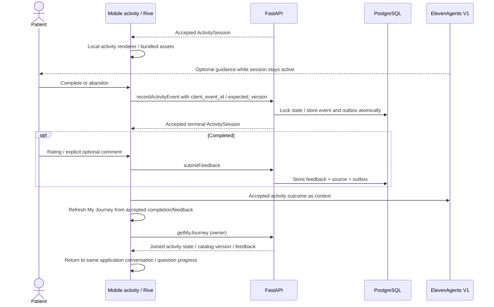
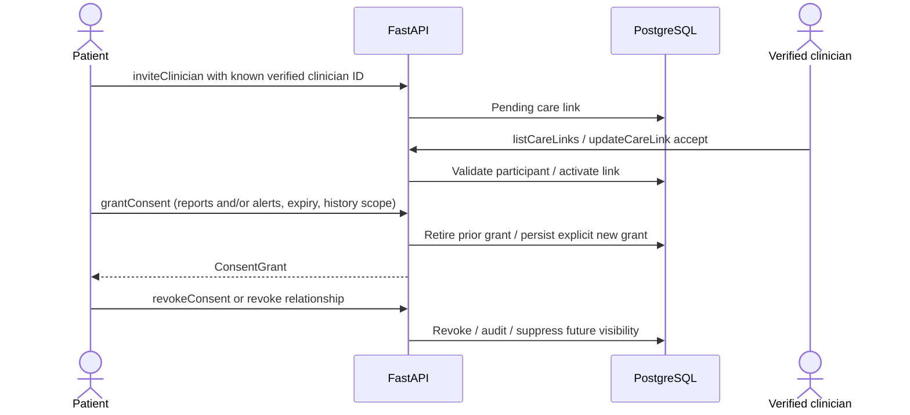
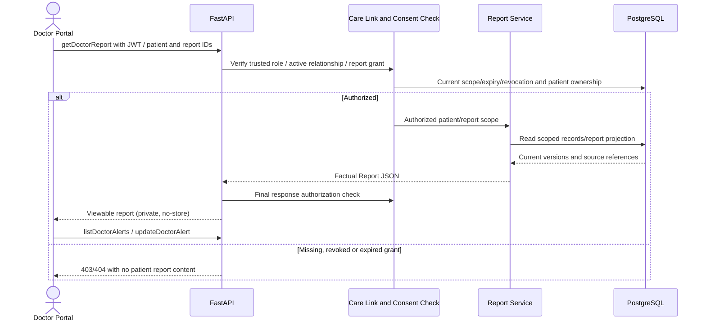

# RE:SONANCE — User flows

Status: planning contract v2.0.0, 14 November 2026. Proposed; no application functionality is implemented. Fictional patient data only.

All diagrams describe proposed behavior, not observed execution. HTTP names are canonical OpenAPI operationIds.

## 1. Registration and onboarding



Unverified registration may not yield a session; wait for provider verification. A clinician is operator-provisioned, not selected from a public role toggle.

## 2. Patient login



Expired/invalid JWT returns 401; refresh once through Supabase, then retry. Do not send refresh tokens to FastAPI.

## 3. Starting an ElevenAgents V1 voice conversation

```mermaid
sequenceDiagram
  participant M as Mobile / ElevenLabsAdapter
  participant F as FastAPI / Python Controller
  participant E as ElevenAgents
  participant D as PostgreSQL
  M->>F: createConversation mode=voice (no camera field)
  F->>D: Persist application conversation
  F-->>M: ConversationSession
  M->>F: createAgentConnection(mode=voice, expected_version)
  F->>F: Verify owner / session / actual agent privacy attestation
  F->>D: Allocate owned connection ID / epoch and context snapshot
  F->>E: Private WebRTC conversation token (server API key)
  E-->>F: Token / opaque provider conversation ID
  F-->>M: ElevenLabsVoiceBootstrap (no-store)
  M->>E: Start authenticated audio-only WebRTC
  M->>F: updateAgentConnection active
  opt User chooses local camera preview
    M->>M: Separate camera permission and native preview
    M->>M: Display camera-preview-only disclosure; no frame export
  end
  E-->>M: Voice / message events / client tools
```

UI shows “Camera preview only — RE cannot see your video yet.” No camera field/image/video travels to FastAPI or ElevenLabs. Microphone and camera permission/lifecycle are independent. No Gemini key/SDK/bootstrap is involved.

## 4. Separate text mode, same application context

```mermaid
sequenceDiagram
  actor P as Patient
  participant M as Mobile / VoiceAgentAdapter
  participant F as FastAPI / Python Controller
  participant E as ElevenAgents
  P->>M: Switch to text mode
  M->>E: Disconnect voice transport
  M->>F: updateAgentConnection closed (old connection)
  M->>F: updateConversation mode=text; keep application session ID
  M->>F: createAgentConnection(mode=text, expected_version)
  F->>F: Current owner/context and agent privacy verification
  F->>E: Obtain private signed WebSocket URL
  F-->>M: ElevenLabsTextBootstrap and same application AgentContext
  M->>E: Open textOnly WebSocket; no microphone/audio capture
  P->>M: Typed message
  M->>E: Send typed input
  E-->>M: Text reply / client-tool events
  opt Active RE transcript-storage grant
    M->>F: ingestMessages with owned connection ID/epoch
  end
```

Switching provider native conversation IDs does not reset Python controller, current recommendation or accepted activity. Restore only approved context; do not secretly retain/upload a transcript when history is off. Camera releases on call-view unfocus/unmount, not as a side effect of SDK disconnect. Reverse switch uses a fresh voice connection under the same application conversation.

## 5. ElevenLabs activity recommendation



Rank deterministically: active supported catalog rows, preferred kind/duration compatibility, prior personal feedback and recent completion, stable ID tie-break. Do not infer medical suitability or fabricate catalog entries.

## 6. Synchronized voice and interactive cards



Late batches are discarded/reconciled before narration. Two simultaneous choices cannot create two running activities. Backend never trusts an activity title as identity.

## 7. Activity execution, feedback and conversation return



Local animation is not a network event. Offline completion is visibly pending until accepted; abandonment is not counted as completion.

## 8. Conversation persistence and observation extraction

```mermaid
sequenceDiagram
  participant G as ElevenAgents V1
  participant B as Mobile Bridge
  participant F as FastAPI
  participant C as Conversation / Extraction modules
  participant D as PostgreSQL
  actor P as Patient
  G-->>B: User/agent message events (tentative/final as supported)
  B->>B: Normalize owned connection epoch, speaker, turn and finality
  alt Active transcript grant
    B->>F: ingestMessages (grant ID / bounded events)
    F->>D: Lock/check consent and session ownership
    F->>C: Validated final or interrupted turns
    C->>D: Store consented history and source-linked summary
    C->>C: Propose facts only from patient speech
  else History disabled
    B->>B: Discard transient transcript; no upload
    P->>F: Explicit guided answer or observation proposal
    F->>D: Structured source; no hidden transcript
  end
  F-->>P: Proposed observation / confirmation UI
  P->>F: confirmObservation or correctObservation
  F->>D: Confirm/new correction + lineage + report invalidation
```

Model tool proposals do not confirm themselves. Direct guided answers can be confirmed structured input. Disconnect labels partial history and does not invent lost turns.

## 9. Report generation and patient viewing

```mermaid
sequenceDiagram
  actor P as Patient
  participant F as FastAPI
  participant D as PostgreSQL
  participant J as Optional jobs / Report Service
  P->>F: requestReport with period
  F->>D: Pending report + outbox in transaction
  F-->>P: ReportReceipt (202)
  J->>D: Safely claim job / read current confirmed records
  D-->>J: Facts / completions / feedback / assessment responses / sources
  J->>J: Factual counts/means/deltas and coverage; shape Report JSON
  J->>D: Fence lease / atomically save version and sources
  P->>F: getReport (owner)
  F->>D: Owner-scoped current report
  F-->>P: Viewable structured JSON (no PDF)
```

Optional job module may be invoked synchronously by a supervisor/entrypoint but never loses the durable request. Corrections mark stale and enqueue refresh; pending report is not presented as ready.

## 10. Doctor linking and scoped consent



Accepting a link grants no report access by itself. Transcript retention consent has no clinician and does not grant sharing. No email or external message is sent by this plan.

## 11. Doctor reports, follow-up and revocation



Review requests become visible only with alerts scope; no push delivery is implied. Previously viewed or already-authorized in-flight responses cannot be recalled after revocation.

## 12. Local camera lifecycle without voice coupling

```mermaid
sequenceDiagram
  actor P as Patient
  participant U as Call UI
  participant C as LocalCameraPreviewController
  participant V as ElevenLabsAdapter
  P->>U: Toggle Camera preview on
  U->>C: Request camera permission independently
  alt Camera allowed and view focused/foreground
    C-->>U: Render native local preview only
    U->>U: Camera preview only — RE cannot see your video yet.
  else Denied or unavailable
    C-->>U: Explain preview unavailable
  end
  V-->>U: Voice disconnect / reconnect event
  U->>U: Update voice status only; no camera mutation
  P->>U: Camera off or leave/background view
  U->>C: Unmount/release preview independently
```

There is deliberately no camera-to-provider/backend arrow. Camera denial/off does not terminate voice; microphone denial does not prevent a local preview on the focused call view.
